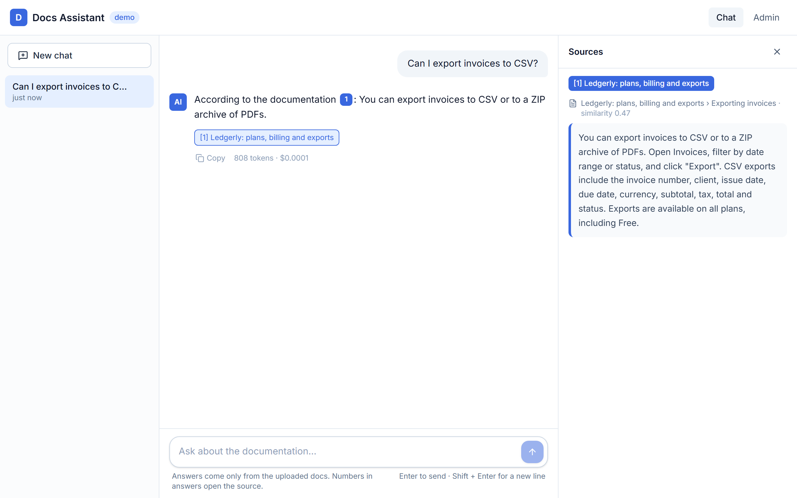
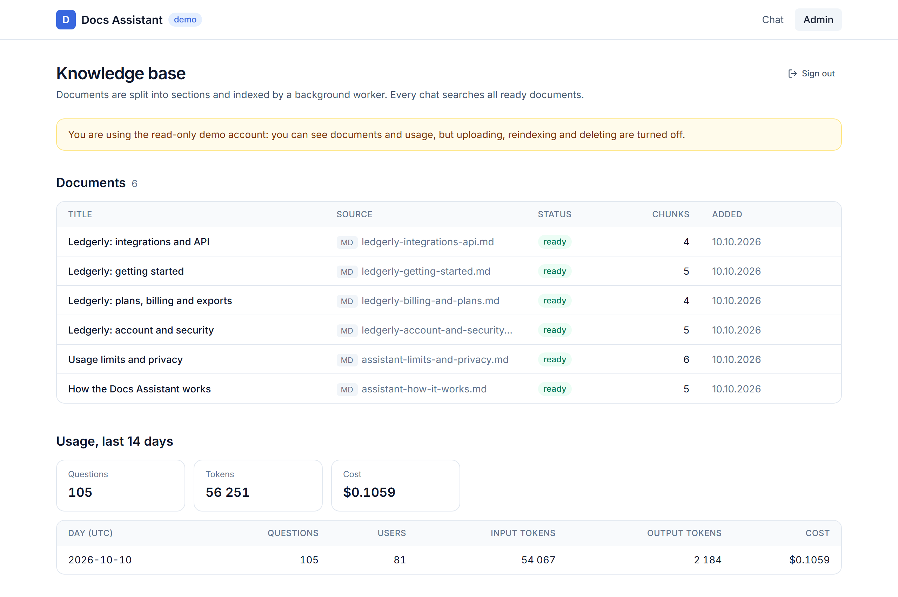
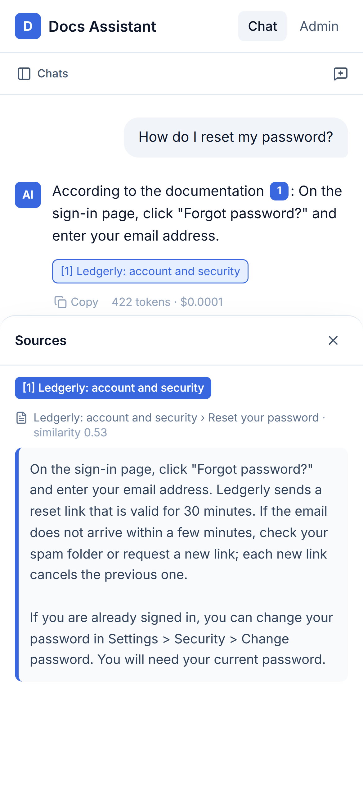
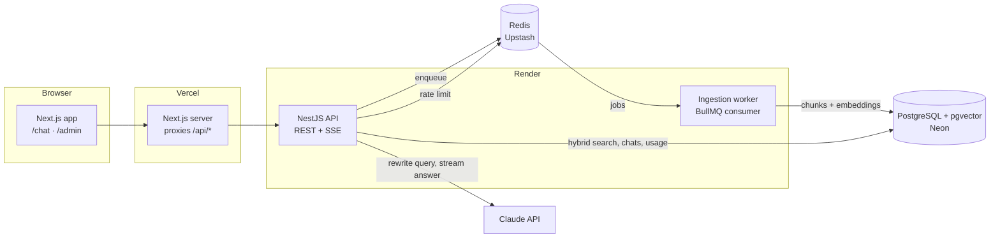

# Docs Assistant

An AI support chat that answers questions from your product documentation, **cites the exact fragment each answer
comes from**, and says “the docs don’t cover this” instead of guessing.

Upload Markdown, PDF or web pages in the admin panel; a background worker indexes them into PostgreSQL + pgvector;
customers ask questions in a streaming chat answered by Claude. Search runs on local keyword embeddings, so Claude is
the only paid API, and a keyless fake model makes local development and tests free.

<!-- Live demo: add the Vercel URL here after deployment -->



| Admin panel (read-only demo account)       | Mobile                                               |
| ------------------------------------------ | ---------------------------------------------------- |
|  |  |

> Screenshots are taken with the keyless fake model (`LLM_PROVIDER=fake`), which answers with the best-matching
> sentence of the top source. With Claude the answers are written by the model, with the same citations.

## Features

- **Retrieval-augmented answers with citations.** Every statement is tied to a numbered fragment; clicking `[n]`
  opens the source text, its document and similarity score.
- **Answers from all documents.** Documents are split by section; a question is rewritten by Claude into a
  standalone English search query (follow-ups, other languages, synonyms) and searched with hybrid search:
  Postgres full-text (stemmed) and pgvector, merged with Reciprocal Rank Fusion. The top 8 fragments usually come
  from several documents.
- **Honest “not covered”.** The model may answer only from the fragments it was given; with nothing relevant it is
  told so and declines.
- **Streaming over Server-Sent Events**, with a Stop button. Closing the tab aborts the upstream model request.
- **Pluggable model layer.** `LlmProvider` / `EmbeddingProvider` interfaces: Claude and a keyless fake for chat,
  local keyword embeddings for search. The services never import a vendor SDK directly.
- **Background ingestion.** Upload (several files at once) → BullMQ job → extract (Markdown, PDF, HTML) → split by
  section (~300 tokens, each chunk starts with “Title › Section”) → embed in batches → atomic swap of a document’s
  chunks. 4 attempts with exponential backoff, then `failed` with
  the reason shown in the admin panel.
- **Cost control for a public demo.** Per-visitor sliding-window rate limit in Redis (atomic Lua script), daily token
  budgets per visitor and for the whole app, cost in USD recorded for every answer, usage dashboard.
- **Chat list.** Anonymous visitors get an httpOnly cookie; their chats are listed (switch, delete, start new), the
  open chat is in the URL, and nobody else can read them. The last 24 messages are sent with each question, and
  answers can be up to 8,000 tokens long.
- **Admin roles.** Full admin plus an optional read-only demo account, so the admin panel can be shown publicly.

## Architecture



**How a question is answered**

1. Rate limit and daily budgets are checked (HTTP 429 with a clear message if exceeded).
2. Claude rewrites the question, with the conversation so far, into a standalone English query with synonyms
   (“а на телефоне?” → “reset password mobile app sign in”).
3. Hybrid search over all chunks: Postgres full-text search (`ts_rank_cd`, English stemming) and pgvector
   (`ORDER BY embedding <=> $1`, HNSW index, relevance cutoff), merged with Reciprocal Rank Fusion, top 8.
4. The model gets the numbered fragments, the last 24 messages and instructions to answer only from the fragments
   and cite them as `[n]`.
5. Tokens stream to the browser as SSE events: `meta`, `delta`…, `citations`, `done` (or `error`).
6. The answer, the citations it actually used, and token usage with cost are stored.

**Design decisions**

| Decision                                          | Why                                                                                                                                                 |
| ------------------------------------------------- | --------------------------------------------------------------------------------------------------------------------------------------------------- |
| pgvector instead of a vector database             | One database for documents, chunks, chats and usage; transactional reindexing; fewer services to run                                                |
| `pg` with SQL, no ORM                             | Vector queries and aggregates are plain SQL; every query is visible and parameterized                                                               |
| Worker as a second entry point of the API package | Shares config, DB and provider modules; on free hosting it can run inside the API process                                                           |
| POST + SSE read with `fetch`                      | The question goes in the body; EventSource only supports GET                                                                                        |
| Browser talks only to the Next.js origin          | `/api/*` is proxied, so the visitor cookie is first-party and no CORS is needed                                                                     |
| Hybrid search + Claude query rewriting            | Full-text search catches exact terms and word forms, vectors catch overlap in wording, the rewrite handles follow-ups, other languages and synonyms |
| Fake LLM, local keyword embeddings                | Deterministic, free tests of the full pipeline, including the browser tests in CI                                                                   |

## Stack

Next.js 16, React 19, TypeScript, Tailwind CSS 4, TanStack Query · NestJS 11, BullMQ, PostgreSQL 16 + pgvector,
Redis · Anthropic SDK (Claude) · Zod (shared schemas) · Jest, Testcontainers, Playwright · pnpm workspaces,
GitHub Actions.

```
apps/api        NestJS API (src/main.ts) and ingestion worker (src/worker.ts)
apps/web        Next.js app: landing, chat, admin
packages/shared Zod schemas and DTO types used by both
migrations      SQL migrations (node-pg-migrate)
corpus          Demo documents loaded by `pnpm seed`
e2e             Playwright browser tests
```

## Run locally

Requires Node 22+, pnpm and Docker.

```bash
pnpm install
cp .env.example .env            # works as is: fake model, no API keys needed
docker compose up -d            # Postgres + pgvector, Redis
pnpm migrate
pnpm --filter @docs-assistant/shared build
```

Then, in three terminals:

```bash
pnpm dev:api      # http://localhost:3001
pnpm dev:worker   # or set RUN_WORKER_IN_API=true and skip this one
pnpm dev:web      # http://localhost:3000
```

Load the demo documents (a help center of **Ledgerly, a fictional invoicing app**, plus docs about this project):

```bash
pnpm seed
```

Admin login: `ADMIN_EMAIL` / `ADMIN_PASSWORD` from `.env`.

### Using Claude

Set in `.env`:

```bash
LLM_PROVIDER=anthropic
ANTHROPIC_API_KEY=...
```

Search needs no key: embeddings are computed locally from the words of each chunk.

## Tests

```bash
pnpm --filter @docs-assistant/api test   # unit: chunking, prompt, citations, cost, providers, config
pnpm test:e2e                            # API e2e against Postgres + Redis in Testcontainers
pnpm test:browser                        # Playwright: upload → index → ask → citation, on desktop and mobile
pnpm lint && pnpm typecheck && pnpm format:check
```

The browser tests need the local stack running (`docker compose up -d`, `pnpm migrate`); dev servers that are
already running are reused. CI runs all of the above on every push and pull request.

## Deploy

Free tiers: **Neon** (Postgres), **Upstash** (Redis), **Render** (API), **Vercel** (web).

1. **Neon.** Create a project and copy the _direct_ (non-pooled) connection string with `?sslmode=require`.
   The first migration enables the `vector` extension.
2. **Upstash.** Create a Redis database (eviction off) and copy the `rediss://` URL.
3. **Render.** New → Blueprint → this repository. `render.yaml` creates the API service; enter the secrets
   (`DATABASE_URL`, `REDIS_URL`, `ANTHROPIC_API_KEY`, `ADMIN_EMAIL`, `ADMIN_PASSWORD`) in the dashboard.
   Claude is the only paid API. On the free plan the worker runs inside the API (`RUN_WORKER_IN_API=true`); with a paid plan add a
   Background Worker with start command `node apps/api/dist/worker.js` and set it to `false`.
4. **Vercel.** Import the repository with root directory `apps/web`. Environment variables:
   `API_URL` (the Render URL), and optionally `NEXT_PUBLIC_GITHUB_URL`, `NEXT_PUBLIC_DEMO_VIEWER_EMAIL`,
   `NEXT_PUBLIC_DEMO_VIEWER_PASSWORD` (same values as on Render).
5. Load the demo documents into production: `API_URL=https://<render-url> ADMIN_EMAIL=... ADMIN_PASSWORD=... pnpm seed`.

With `NODE_ENV=production` the API refuses to start with the default admin password or JWT secret, and the visitor
cookie is `Secure`.

**Free tier notes:** a free Render service sleeps after 15 minutes without traffic, so the first request after a
pause takes up to a minute. The worker polls Redis sparingly (`drainDelay` 30 s) to stay within Upstash’s free
command quota.

## Limitations

- One admin account from environment variables; no user management.
- Visitors are anonymous: clearing cookies resets their limits, which is why there is also a global daily budget.
- Token budgets are checked before a request, so one in-flight answer can go slightly over the limit.
- The fake model is for development and tests only; it doesn’t write answers, it quotes the best-matching sentence.
- Embeddings are keyword-based (hashed bag of words), since Anthropic has no embeddings API. They compare words,
  not meaning; Claude’s query rewrite (which adds synonyms) and stemmed full-text search cover most of the gap, and a
  semantic embedding model can be plugged in behind the same `EmbeddingProvider` interface.
